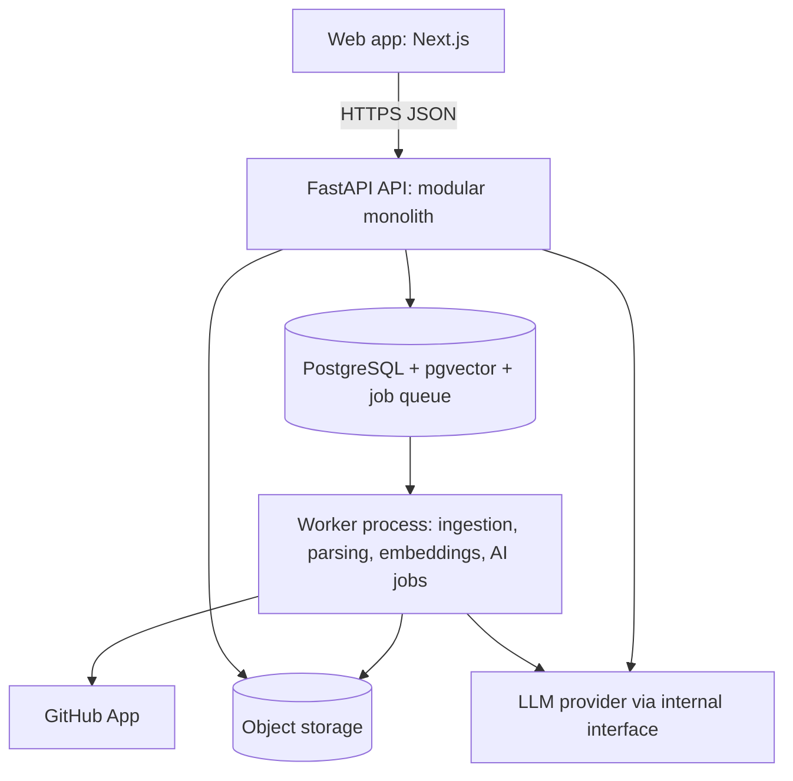
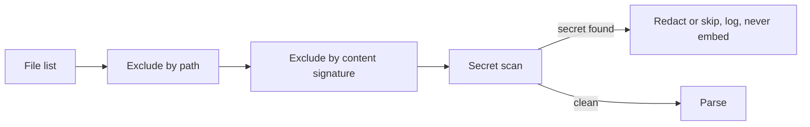

# BrainWhite: Engineering Guide

The single source of truth for what we build and how. It merges the Engineering Bible (V1), the Ingestion Pipeline note, and our earlier planning docs. If something here must change, change it in a pull request and update this file.

> Status: **planning, no application code yet.** Nothing here is claimed to be built or tested.
> Labels: **[Decided]** confirmed by the founder. **[Recommendation]** a proposal. **[Open]** not decided, see section 16. Where a recommendation depends on facts from outside (GitHub, LLM providers), it says **[Verify]**.

Setup, CI/CD and task assignment are in [SETUP.md](SETUP.md). The first week is a thin demo slice, planned in [WEEK1-PLAN.md](WEEK1-PLAN.md), which overrides the timeline and scope below for that week.

---

## 1. Product and MVP scope

BrainWhite is a B2B developer onboarding and readiness platform. It turns a company's codebase and docs into project knowledge, then combines that with one developer's profile and evidence to produce a personalized learning path, project-specific assessments, and a readiness signal.

```
Company code + docs -> Knowledge Engine (ingest -> code intelligence -> knowledge store -> grounded Q&A)
Developer profile + evidence + Knowledge Engine -> Onboarding Engine (skill gap -> learning -> assessment -> readiness)
-> developer app + manager dashboard
```

**Two-engine invariant:** the same project must give different paths to developers with different skills and evidence. If two different developers get the same path, personalization is broken.

### 1.1 V1 goals (P0)

1. Connect selected GitHub repos through a GitHub App.
2. Ingest repository files asynchronously, with safe filtering.
3. Build deterministic code intelligence: files, symbols, relationships, technologies, source locations.
4. Store searchable knowledge in PostgreSQL with pgvector.
5. Answer repo questions with retrieval, relationship context and source citations.
6. Build a developer profile and skill model.
7. Calculate a transparent skill gap against project needs.
8. Generate a project-specific learning path with real code examples and mini tasks.
9. Generate repo-grounded assessments and an evidence-backed readiness view.
10. Give developers, admins and managers a usable UI.
11. Measure onboarding outcomes from day one.
12. Ship through staging with automated tests and a production release gate.

### 1.2 Out of V1

Slack/Teams, Jira, IDE extension, PR intelligence, Skill Passport, shared team workspace, advanced analytics, SSO/SCIM, complex multi-agent orchestration, microservices, autonomous code changes, any write access to customer repos.

If a feature does not directly improve secure ingestion, trustworthy project understanding, personalized onboarding, assessment, readiness, or the first design-partner outcome, write an ADR before adding it.

### 1.3 First customer [Recommendation]

Product companies with 30-300 engineers, 1-3 core repos, TypeScript or Python, hiring regularly (3+ per quarter). Buyer: VP/Director of Engineering or Engineering Enablement. Daily users: new developers and managers. MVP languages: **TypeScript and Python** [Decided].

### 1.4 Score policy [Decided]

Readiness is used for onboarding support, task preparation and internal skill tracking. It is **not** used for hiring, performance reviews or pay decisions. Every screen with a score says it is an indicator of demonstrated repository knowledge, not a measure of overall ability.

---

## 2. Decisions

| Decision | Value | Status |
|---|---|---|
| Stack | Python (FastAPI), Next.js (TypeScript), PostgreSQL + pgvector | Decided |
| Architecture | Modular monolith, one worker process, no microservices | Decided |
| Job queue | Postgres-backed queue (no Redis in V1) | Decided |
| Repositories | One monorepo for app, infra and evals | Decided |
| Branching | `main` (production), `develop` (staging), short `feature/<name>` branches | Decided |
| Team split | P1 Product/Frontend, P2 Backend/Platform, P3 AI/Code Intelligence, P4 Infra/QA/Security | Decided |
| LLM | Hosted API with zero-retention contract, behind our own provider interface | Decided |
| Hosting | Local first, free-tier options later | Decided |
| Git host | GitHub, through a GitHub App (never personal tokens) | Decided |
| Customer source code | Must not be stored by us; re-fetching must not be slow | Decided |

---

## 3. Architecture



| Component | Does | Must never |
|---|---|---|
| Web | UI, polling job state | Access the database directly, hold provider secrets |
| API | AuthN/AuthZ, CRUD, orchestration, fast reads | Run long repo parsing or generation |
| Worker | Long jobs: ingestion, parsing, embeddings, generation | Trust a job payload without validating it |
| Postgres | System of record, relations, vectors, job queue | Store plaintext secrets |
| Object storage | Artifacts and temporary snapshots | Be publicly readable |
| LLM provider | Reasoning, generation, embeddings | Receive a whole repository |

### 3.1 Technology choices

| Layer | Choice | Why | Not chosen |
|---|---|---|---|
| Backend | FastAPI, Pydantic | Best ecosystem for parsing and LLM work, schema validation | Node |
| Frontend | Next.js + TypeScript | Standard, good for dashboards | Custom SPA |
| Database | PostgreSQL, row-level security, pgvector, full-text search | One system for relational data, vectors and search | Neo4j, Elasticsearch, separate vector DB (too early) |
| Graph | Node and edge tables | Enough at MVP scale | Neo4j |
| Parsing | tree-sitter, plus language-specific extraction | Fast, never runs code | Language servers as primary (heavy), later for resolution |
| Queue | Postgres-backed (for example Procrastinate) | One less service to run and secure | Redis + Celery/RQ |
| LLM layer | Thin in-house provider interface | Swap providers, budgets, redaction, usage logs | LangChain |
| Monitoring | OpenTelemetry, structured logs, Sentry | Vendor neutral | Custom |
| Auth | **[Open]** managed provider or local dev stub | See section 16 | Our own auth |

### 3.2 Repository layout [Recommendation]

```
brainwhite/
  apps/web/                  # Next.js
  apps/api/                  # FastAPI entrypoint
  apps/worker/               # worker entrypoint
  packages/{api-contracts,ui,config}/
  backend/
    modules/                 # auth, organizations, projects, repositories, ingestion,
                             # code_intelligence, knowledge, chat, developers,
                             # learning, assessments, readiness, analytics, jobs
    core/                    # authz, tenancy, database, events, errors, observability, settings
    ai/                      # provider, prompts, retrieval, generation, evaluation
  migrations/
  parsers/                   # tree-sitter, language extractors, normalizers
  evals/                     # golden questions, retrieval and prompt regression tests
  infra/                     # docker-compose.yml, deployment config
  tests/{unit,integration,contract,security,e2e,fixtures}/
  docs/{adr,runbooks}/
  .github/ CLAUDE.md SECURITY.md README.md
```

Rules: a module never imports another module's internals, only its public interface. `api` is thin (validate, authorize, call a service). Split a module into a service later only for a measured reason (independent scaling, a security boundary, heavy CPU load, different release cadence).

### 3.3 Configuration

- All config comes from environment variables and is validated at startup.
- Secrets never go in Git, images, logs, database rows or client bundles.
- Separate credentials per environment. Provider and model names are config.
- New or unfinished features sit behind flags that default to off.
- A migration that is applied to a shared environment is never edited.

---

## 4. Repository ingestion and privacy

Fetching a customer's code is the riskiest thing we do. The rule for every decision: **access only what we need, only while we are allowed, and prove it in a log.**

### 4.1 Access: GitHub App only

| Option | Verdict |
|---|---|
| Personal access token | No: tied to one person, over-scoped, breaks when they leave |
| User OAuth | No: access follows a person, not the organization |
| **GitHub App installation** | **Yes** |

Why: the organization installs it, the admin picks exact repos, permissions are fine-grained, the client can revoke in one click, and actions are attributable to the App.

Install flow:
1. An org admin installs the App and selects specific repos only (not "all repos" by default).
2. GitHub sends an `installation.created` webhook with an `installation_id`. We store it scoped to `organization_id`.
3. Per job, we request a short-lived installation token from GitHub (about one hour). **We never store the token.**
4. We fetch content with that token.

Permissions, nothing extra: `contents: read`, `metadata: read`. Later, optionally `pull_requests: read`. Never request write, admin, secrets or actions. **[Verify]** against GitHub's current App documentation, including what is needed to receive push events. Keep the App private key only in the environment's secret manager.

Uninstall or repo removal is a security event: stop all jobs for it immediately and mark it `REVOKED`.

### 4.2 Keeping knowledge fresh: incremental sync

Do not re-clone on a schedule. Use deltas:

1. GitHub sends a `push` webhook. We verify the signature and store an idempotency receipt.
2. If the installation is not active, drop and log the event.
3. Enqueue a delta-sync job with `repo_id` and `commit_sha`.
4. Compare with `last_synced_commit` (GitHub Compare API) and fetch only changed files.
5. Re-parse and re-embed only those files, invalidate affected knowledge, update `last_synced_commit`.
6. A fallback poll (about every 24 hours) only catches missed webhooks.

### 4.3 Data minimization: filter before touching content



- Never fetch: `node_modules/`, `vendor/`, `dist/`, `build/`, `.git/`, lockfiles (except for technology detection), `.env*`, `*.pem`, `*.key`, `*.p12`, `secrets/`, `credentials/`, `.aws/`, `.ssh/`.
- Flag by content: high-entropy strings, `.tfvars`, `docker-compose.override.yml`.
- Run a Gitleaks/Trufflehog-style scan before chunking and embedding. A secret that reaches an embedding is effectively leaked until the store is rebuilt.
- Keep config files that describe runtime architecture. Allow project-level include and exclude rules.

### 4.4 Source code storage [Recommendation, needs confirmation]

The Decided rule is that we do not store customer source. The Bible's design stores file content and chunk text. To satisfy both:

- **Ephemeral mode (default):** source lives only on an encrypted temporary volume during the job, then is wiped. We keep derived data: symbols, relationships, summaries, embeddings, evidence pointers (path, line range, commit, content hash). Snippets needed for tutoring or answers are re-fetched in one batch at session start and held in an encrypted in-memory cache that is purged when the session ends.
- **Persistent mode (opt-in, customer authorizes in writing):** chunk text and file content may be kept for a stated period.
- Embeddings and summaries can still reveal confidential logic. Treat them as confidential, per tenant, encrypted.
- Never say "we store no customer data". Say what is kept, for how long, and how to delete it.

Whether Ephemeral is truly the MVP default is open decision #1.

### 4.5 Pipeline

```
CONNECT -> DISCOVERING -> FETCHING -> FILTERING -> PARSING -> RELATIONSHIPS -> CHUNKING -> EMBEDDING -> INDEXING -> READY
any stage -> RETRYABLE_FAILURE (retry with backoff) | PERMANENT_FAILURE (FAILED with a readable reason)
```

| Failure | Action |
|---|---|
| GitHub rate limit | Retry after the provider's delay, show an estimate |
| Network timeout | Retry with bounded exponential backoff and jitter |
| Unsupported language | Keep file metadata, skip the parser, do not fail the repo |
| Parser error | Record a file-level error, continue |
| Embedding provider error | Retry, then mark indexing incomplete and alert |
| Invalid permissions | Stop, mark `authorization_failed` |
| Duplicate job | Deduplicate by repo + commit + pipeline version |

Idempotency: the same repo at the same commit produces the same artifacts. Use content hash and commit SHA as keys. A re-run must not duplicate files, symbols, chunks or relationships.

### 4.6 Audit log

Every ingestion job writes one row, independent of the vector store:

```
ingestion_audit_log: id, organization_id, repository_id, installation_id,
  triggered_by (webhook | manual | scheduled), files_fetched_count, files_excluded_count,
  secrets_flagged_count, commit_sha_range, started_at, completed_at, status
```

It answers what we accessed and when, whether we stayed within what was authorized, and that nothing was pulled after revocation.

### 4.7 Data lifecycle

- On `installation.deleted`: stop all sync, flag the org `access_revoked`.
- On a deletion request: **hard-delete** code files, symbols, chunks and embeddings for that organization. Keep only audit log rows, stripped of content.
- Write a retention period down, even for active customers (for example: raw content only as long as needed, superseded versions purged on the next sync).
- Proof for a deletion claim: deletion job logs, a storage listing after deletion, row counts, per-tenant key revocation, documented backup expiry, and the LLM provider's contract.

### 4.8 Contracts to have before the first external install

- A Data Processing Agreement: what we access, why, retention, sub-processors (LLM provider, cloud host), deletion process.
- Written confirmation that content sent to the LLM provider is covered by zero-retention and no-training terms. Do not assume; read the terms of the provider we pick.
- A stated position on sub-processor changes that customers' DPAs may require us to announce.

P4 treats "DPA drafted and reviewed" as an early deliverable, not an afterthought.

---

## 5. Data model

### 5.1 Tables

| Domain | Tables |
|---|---|
| Identity | users, organizations, organization_members |
| Projects | projects, project_members |
| Repositories | repositories, repository_syncs, repository_commits, source_versions |
| Code | code_files, code_symbols, code_relationships |
| Knowledge | document_chunks, citations, technologies, project_technologies, knowledge_sources |
| Developer | developer_profiles, developer_skills, skill_evidence |
| Learning | learning_paths (versioned), learning_modules, learning_progress |
| Assessment | assessments, assessment_questions, assessment_attempts, evaluations |
| Readiness | task_requirements, readiness_snapshots |
| Conversation | conversations, messages |
| Operations | jobs, ingestion_audit_log, ai_runs, audit_events, retention_policies |

Add the later tables only when the feature is built. Do not fill them with guessed fields.

### 5.2 Rules

- Every tenant table has `organization_id`, enforced by **PostgreSQL row-level security** (RLS), not just by convention. The app's database role must not bypass RLS.
- Foreign keys enforce ownership where possible (composite `(organization_id, id)`). Unique keys include the org, for example `(organization_id, slug)`.
- Embeddings always keep a source pointer and a source version.
- No shared embeddings across tenants, even for identical open-source dependencies.
- Per-tenant encryption keys, or at least an envelope scheme per tenant.
- Vector queries are always filtered by `organization_id`, through one wrapper that makes an unscoped query impossible to call.
- Public identifiers are validated at the API boundary and never expose internal IDs where a stable public ID fits.
- Soft delete only where audit needs it.
- Keep temporary processing state (job state, ephemeral files, caches) apart from durable business data, with TTLs.
- `organization_id` scope: one organization per customer company [Recommendation]. Fix this before writing any RLS policy, since changing it later touches every table. **[Open]** confirm.

### 5.3 Stale knowledge

New commit, then diff, then changed files and symbols. Compare content hashes: unchanged nodes keep their summaries. Re-check direct neighbors. Mark dependent learning modules and questions `stale_pending_review`, and old evidence `outdated`. A person reviews. Nothing republishes silently. Regeneration makes a **new path version**, so completed history is never rewritten.

---

## 6. Code intelligence and retrieval

### 6.1 Code intelligence

| Layer | Approach | Purpose |
|---|---|---|
| Syntax | tree-sitter | Fast deterministic parsing |
| Symbols | AST extraction | Functions, classes, methods, imports, exports |
| Resolution | Language servers or static analysis where practical (later) | Resolve calls across files |
| Relationships | Normalized graph builder | Typed edges |
| History | Git metadata | Co-change and rationale (later) |
| LLM | Provider interface | Summaries and architecture labels, **not** the source of truth |

Relationship types: IMPORTS, CALLS, EXTENDS, IMPLEMENTS, INSTANTIATES, READS, WRITES, PUBLISHES, CONSUMES, ROUTES_TO, DEPENDS_ON, DEFINED_IN. The graph must be able to answer chains like Controller -> Service -> Repository -> database.

Minimum parsing artifacts:

| Artifact | Fields |
|---|---|
| Code file | path, language, hash, commit_sha, line_count, content_ref |
| Symbol | kind, name, qualified_name, file_id, start_line, end_line, signature |
| Relationship | source_symbol, target_symbol, type, confidence, provenance |
| Chunk | text (or pointer), file_id, start_line, end_line, symbol_id, embedding, source_version |

Embeddings alone cannot understand a repo. Structure first, meaning second. Build a read-only architecture explorer first; do not wait for a pretty graph before the relationship data is trustworthy.

### 6.2 Retrieval

```
question -> normalize intent -> authorized sources only
 -> hybrid retrieval: vector + lexical/symbol + relationship expansion
 -> rank -> 5-10 primary chunks + graph context -> bounded context
 -> LLM answer -> validate citations -> answer + citations + open-in-code links
```

| Task | Strategy |
|---|---|
| Symbol question | Exact symbol hits first |
| Flow or architecture | Expand through relationships, entry points, README |
| Function explanation | Symbol, callers and callees, tests |
| Debugging scenario | Symbol, error paths, tests |
| Skill or path generation | Graph clusters and centrality, not top-K chunks |

Rules:
- Never send the whole repo to the model. Respect token budgets.
- Apply tenant, project and source authorization **before** ranking and building context.
- Every code claim is traceable to a source artifact. Record retrieval IDs.
- Citation = repository, commit, path, line range, symbol, URL.
- Code (not the model) verifies each citation: the id exists, the path and line range are valid, the quoted text is in the file. A failed claim is dropped or regenerated. If evidence is still missing, say so and ask a clarifying question.
- Never invent file paths, symbols, line numbers, commits or services.
- Skip unchanged content: content hashes per file and symbol, summaries only for changed symbols, prompt caching, a cheaper model for extraction and a stronger one for generation and grading, a token budget per job with a hard stop.

---

## 7. Developer model, learning, assessment, readiness

### 7.1 Skill model

A skill is a level **plus evidence**, never one unexplained percentage.

| Evidence | Example |
|---|---|
| Declared experience | Profile says Java/Spring, 3 years |
| Baseline assessment | Explained Spring dependency injection correctly |
| Module assessment | Passed the Kafka consumption module |
| Task evidence | Completed a task touching `OrderService` |
| Project familiarity | Navigated the payment flow correctly |
| Mentor evidence | Optional structured observation, later |

Skill gap = required level minus evidenced level, weighted by project importance, target task and evidence freshness. The output is explainable, for example: "Kafka event consumption is a high-priority gap because the payment flow uses Kafka and the baseline showed weak understanding."

Repo-specific knowledge and general fundamentals are tagged separately. General items may link out or be skipped.

### 7.2 Learning

| Module field | Meaning |
|---|---|
| objective | What the developer can explain or do afterward |
| project_context | Why it matters in this codebase |
| code_examples | Exact repo locations (citations) |
| mini_task | Small applied activity |
| assessment_ref | Evidence check |
| estimated_minutes, prerequisites | Planning and order |

Pipeline: project technologies + architecture + developer evidence -> required concepts -> dependency graph -> ordered modules -> attach examples and tasks -> generate assessment -> **validate all source references** -> publish a path version. A manager or admin can review and edit a draft before assignment.

Quality gates:
- Every project-specific example maps to a real source location.
- No module teaches a technology the project does not use or is not configured for.
- Prerequisites form a DAG. Reject cycles.
- Every assessment question maps to a learning objective.

### 7.3 Tutor behavior

Deterministic workflow with bounded LLM steps (not a free-roaming agent): `INTRO -> EXPLAIN -> PROBE -> EVALUATE -> (REMEDIATE | ADVANCE) -> BLOCK_DONE`.

- Code decides transitions, not the LLM. Save a checkpoint on every transition.
- Limits: at most 3 hints per question, 2 remediation loops per objective, a maximum number of turns per block, LLM timeouts with 2 retries, session heartbeat, idle timeout that pauses with a checkpoint.
- Deduplicate questions by (skill, concept, question_version).
- Guess versus understanding: after a correct multiple-choice answer, ask a transfer question in a new scenario. Only both correct count as demonstrated.
- When attempts run out, mark the block "needs mentor". Never loop forever.

### 7.4 Assessment

MVP: multiple-choice and code-comprehension questions generated from the real repo. Adaptive testing, debugging scenarios and sandboxed coding tasks come later.

Flow: select balanced questions by skill and objective -> answers -> score -> attach evidence -> update skill evidence -> recompute readiness.

Per attempt store: skill, difficulty, question version, rubric or expected answer, response, result, evidence, confidence, attempt number, timestamp.

Grading safeguards:
1. Deterministic checks first (multiple choice, trace output, symbol or path identification).
2. LLM grading with an explicit rubric checklist only for answers that need judgment.
3. Grade twice independently. Large disagreement means `needs_review` for a human.
4. Partial credit per rubric criterion.
5. A question that causes grader disagreement is retired and reviewed.
6. Results based on outdated evidence are flagged, not silently trusted.
7. A human-graded calibration set runs on every prompt or model change.

### 7.5 Readiness

Multi-dimensional, never one opaque number:

| Dimension | Meaning |
|---|---|
| Knowledge | Can explain concepts the project needs |
| Code comprehension | Can find and read the relevant code |
| Applied ability | Can complete scoped tasks |
| Project familiarity | Understands key architecture and workflows |
| Evidence freshness | How recent and reliable the evidence is |

Per-role or per-task settings: skill weights, mandatory flags, minimum threshold, minimum evidence count.

| Category | Rule |
|---|---|
| Not assessed | Below minimum evidence |
| Needs support | A mandatory skill below threshold |
| Developing | Mandatory skills met, weighted score below target |
| Ready with guidance | Target met, but low confidence or old evidence on some skills |
| Ready | Target met, mandatory met, enough fresh evidence |

Task-specific readiness compares the skills a real task needs with the developer's evidence, for example: "Ready for low-risk backend changes in Order Management; needs preparation before Payment Infrastructure changes."

Auditable: every score points to evidence, is versioned, and a manager can see why it changed. AI recommendations are labeled recommendations, not facts. Validate against blind mentor ratings in the pilot, and record each calibration version.

Employee dashboard: path, progress, skill levels, history, weak areas, next steps. Manager dashboard: readiness by skill and project, evidence, critical gaps, completion versus competency, last assessment date, confidence, follow-up suggestions.

---

## 8. Background jobs

| Job | Trigger | Idempotency key |
|---|---|---|
| repository.ingestion | Connect or manual sync | repo_id:commit:pipeline_version |
| repository.incremental_sync | GitHub event | repo_id:event_id |
| code.parse | Ingestion stage | repo_id:file_hash:parser_version |
| code.relationships | Parsing done | repo_id:commit:graph_version |
| embedding.generate | Chunk changed | chunk_hash:embedding_model |
| chat.answer | User question | message_id |
| skill.extract | Ingestion done | project_id:source_version |
| learning.generate | Profile or skill change | developer_id:knowledge_version:skill_version |
| assessment.generate | Module published | module_id:version |
| readiness.recompute | Evidence change | developer_id:project_id:evidence_version |

State machine: `QUEUED -> RUNNING -> SUCCEEDED | RETRY_WAIT -> RUNNING | FAILED | CANCELLED`.

Worker safety: validate every payload against a schema, re-check tenant ownership before touching data, timeouts on every external call, bounded retries with jitter, checkpoints at meaningful points, heartbeats, cooperative cancellation, cleanup of temporary files always runs, never log source code, tokens or full prompts that contain customer code.

---

## 9. Security

**Invariant:** a request from organization A must be technically unable to read organization B's repos, code, embeddings, conversations, learning data or derived knowledge, even if the caller guesses an ID.

### 9.1 Authorization layers

Authenticate -> resolve active organization -> check membership and role -> check project membership -> check repository and source access -> apply the tenant filter in the service layer -> for retrieval, apply source permissions before ranking -> audit security-sensitive actions.

| Role | Typical access |
|---|---|
| Owner | Billing, settings, repos, members, projects |
| Admin | Projects, repos, members |
| Manager | Project and developer progress, readiness, metrics |
| Developer | Assigned knowledge, own profile, path and assessments |

### 9.2 Threats

Repo content is **untrusted input**.

| Threat | Defense |
|---|---|
| Prompt injection through README, comments, fixtures | Repo text is data in delimited blocks. Analysis LLM calls have no tools or network. Outputs are schema-validated. Code verifies evidence. The tutor cannot change grading rules. |
| Secrets sent to the LLM | Scan and redact before any LLM call. Store a finding as a pointer, never the value. |
| Malicious archives | Limits on size, count and depth. Reject symlinks leaving the root. Normalize paths. Extract in an isolated directory. |
| Dependency-install attacks | Never run install. Parse manifests only. |
| Unsafe execution | **Never execute repo code in V1.** |
| Exfiltration | Worker network allowlist: GitHub and the LLM provider only. |
| Cross-tenant leaks | RLS, composite FKs, per-tenant keys and object prefix, `organization_id` in every retrieval, CI cross-tenant tests, no shared caches. |
| Git token abuse | Short-lived read-only installation tokens, never stored. |
| Misuse of employee data | A developer sees their own data. A manager sees assigned reports. Every readiness view is audited. |

Platform: TLS everywhere, encryption at rest, secrets from a secret manager, audit events for admin and manager actions, exports and deletions, no raw source or secrets in logs, a documented backup policy, and an incident runbook before the first pilot.

### 9.3 Security tests (release gates)

1. Cross-tenant ID access returns 404 or 403 without revealing existence.
2. Cross-project access is denied. A developer cannot read manager-only metrics.
3. A revoked GitHub installation cannot trigger new reads.
4. Webhook signatures are verified. Expired sessions are rejected.
5. Seeded prompt-injection repos: outputs do not follow injected instructions or reveal secrets.
6. Planted canary secrets never appear in LLM payloads, logs, errors, analytics or client bundles.
7. Zip-slip, symlink and zip-bomb samples are rejected.
8. Deletion is verified for every data class.

---

## 10. API

Conventions: version under `/api/v1`, resource-oriented, explicit authorization on every endpoint, stable machine-readable error codes plus a readable message, idempotency keys where duplicates cause harm, pagination on lists, OpenAPI generated from FastAPI and checked in CI.

| Area | Endpoints |
|---|---|
| Auth | `POST /auth/login`, `POST /auth/logout`, `GET /me` |
| Organizations | `POST /organizations`, `GET /organizations/{id}`, members |
| Projects | `POST /projects`, `GET /projects/{id}`, members, technologies |
| Repositories | `POST /projects/{id}/repositories`, `GET ...`, `POST .../sync` |
| Jobs | `GET /jobs/{id}` |
| Architecture | `GET /projects/{id}/architecture`, `GET /symbols/{id}` |
| Chat | `POST /projects/{id}/conversations`, `POST /conversations/{id}/messages` |
| Developers | `GET/PUT /projects/{id}/developers/{id}/profile`, skills |
| Learning | `POST /developers/{id}/learning-paths`, `GET` path, progress, `PATCH` draft, `POST` publish |
| Assessments | `POST /assessments/{id}/attempts`, `GET` results |
| Readiness | `GET /developers/{id}/readiness` |
| Analytics | `GET /projects/{id}/onboarding-metrics` |
| Data | `PUT /organizations/{id}/retention-policy`, `DELETE /repositories/{id}/data` |

Job status example: `{ "id": "job_01...", "type": "repository.ingestion", "status": "PARSING", "progress": 62, "current_stage": "symbols", "repository_id": "repo_01...", "error": null }`.

---

## 11. LLM and prompts

- One provider interface: `generate`, `embed`, `moderate`. Domain code never imports a vendor SDK.
- Every production prompt has a version, lives in source control, and is recorded on each run. Never edit a production prompt in place without a version change.
- Each important prompt has a small evaluation set in `evals/`.
- Prompts are kept apart from business logic. Generated artifacts use structured output validated by a schema.
- Record one `ai_runs` row per call: organization, purpose, provider, model, prompt_version, tokens, latency, retrieval IDs, success, cost.
- Hallucination controls: separate evidence from inference, require citations for repo claims, answer with uncertainty when retrieval confidence is low, validate citations after generation.

---

## 12. Observability and cost

Essential metrics: `ingestion_duration_seconds`, `ingestion_failure_rate`, `retrieval_hit_rate`, `citation_validation_failure_rate`, `llm_latency_ms`, `llm_cost_usd` (per repo and per learner), `job_queue_depth`, `api_error_rate`, deletion failures, security violation events. Outcome metrics: time to project understanding, time to first meaningful task, mentor interventions needed, questions resolved by AI, readiness trend.

Every request, job, AI run and provider call carries a correlation ID. Logs are structured JSON, include organization, project, job or run, source version, duration, outcome and error class, and never include source code, raw tokens or sensitive prompts. Per-tenant rate limits and LLM budget caps. Later: cache dashboards, SLOs, anomaly alerts.

---

## 13. Testing and release gates

| Layer | Covers |
|---|---|
| Unit | Skill gap, readiness scoring, permissions, path filtering, chunking, relationship normalization, job states, prompt builders, citation validation, API error mapping |
| Integration | FastAPI with Postgres migrations, pgvector retrieval, queue lifecycle, GitHub client with mocked responses, object storage, worker retries and idempotency, multi-org authorization |
| Contract | OpenAPI diffs, frontend types match the backend, webhook fixtures, provider adapter conforms to the interface |
| End to end | Sign up, create project, install GitHub App, ingest, view architecture, developer profile and baseline, two developers get different paths, grounded Q&A with valid citations, module assessment, readiness with evidence, manager view, revoked access blocks retrieval, cross-tenant access blocked |
| AI evals | Retrieval finds the right file, grounding, citation validity, architecture flow, learning objective match, deterministic assessment answers, injection resistance |

Also test failure recovery (kill a worker mid-job, LLM timeout, resume) and load (large repo, many sessions). Adversarial cases: injection in README, comments and fixtures; zip bomb; symlink escape; huge minified file; binary files; secrets in history; unsupported language; empty repo; repo changing mid-analysis; a jailbreak pasted into an answer.

Release gates (starting proposals, recalibrate after the pilot):
- Citation validity 100% on published content.
- Grounded answer accuracy at least 90% on the benchmark.
- Grading agreement at least 85% across repeats and at least 80% with a human.
- Zero cross-tenant leaks and zero leaked canary secrets.
- Deletion verified for all data classes.
- No stuck tutor sessions in tests, repeated questions under 3%.
- A prompt or retrieval change that improves one example but regresses the golden set does not merge.

Benchmark: 5 repos (small TS, small Python, medium monorepo, poor docs, injection samples) with hand-labeled symbols, entry points and questions.

---

## 14. Delivery

Branches: `main` is always releasable and deploys to production after manual approval. `develop` is the integration branch and deploys to staging. Work happens on `feature/<short-name>` branches off `develop`, with pull requests under about 400 lines, squash merge.

PR gate: format, lint, typecheck, unit tests, migration check, integration tests, security tests, build, AI evals when AI or retrieval files changed, reviewer approval.

Deployment safety: never deploy production from a laptop, never auto-apply a destructive migration, run backward-compatible migrations before the code that needs them, keep rollback steps per release, run smoke tests after deploy, protect production credentials with a protected environment. Details and the workflow files are in [SETUP.md](SETUP.md).

Migrations: one per coherent change, never edit an applied one, descriptive names, large backfills as separate jobs, indexes based on measured queries, test upgrade from a clean database and from the previous staging schema.

---

## 15. Team, process and roadmap

### 15.1 Ownership

| Person | Owns | Reviews |
|---|---|---|
| P1 Product / Frontend | UX, developer app, admin, manager, chat UI | User-flow correctness |
| P2 Backend / Platform | API, auth, data integrity, organizations, projects, repositories, jobs | Contracts and persistence |
| P3 AI / Code Intelligence | Parsing, graph, retrieval, embeddings, skill, learning and assessment generation | AI quality and grounding |
| P4 Infra / QA / Security | Docker, CI/CD, monitoring, tenant isolation, test infrastructure, DPA drafts | Security and release gates |

Build in vertical slices: when a feature ships, frontend, backend, AI and infra work on it together, not as separate layers over weeks. The team lead (which P the lead is: **[Open]**) also runs customer discovery and approves contract changes with the owners.

Contracts (`packages/api-contracts`, shared schemas) are frozen in week 1. After that, work proceeds against mocks. A contract change needs a pull request from its owners and a heads-up to all four.

### 15.2 Definition of Ready and Done

Ready: observable outcome, API and data changes identified, security implications identified, test criteria written, owner and reviewer assigned, no open architecture disagreement.

Done: behind the right module boundary, unit tests, integration or end-to-end tests when crossing boundaries, authorization tested, observability added, API contract updated, migration reviewed, docs or runbook updated, shown on staging, no known blocker defect. Say "implemented" only after it was run and tested.

### 15.3 Roadmap (estimates, not commitments)

| Phase | Weeks | Goal | Exit criteria |
|---|---|---|---|
| 0 Discovery | 1-4, in parallel | Validate demand, run a concierge test | 10+ interviews, 3+ interested design partners, a hand-made path tested with one real new hire |
| 1 Foundation and security | 3-6 | Auth, orgs, RLS, CI, LLM interface, audit log, threat model | Tenant isolation tests pass |
| 2 Ingestion and code intelligence | 6-11 | Repo to graph and evidence (TS, Python) | Benchmark of 5 repos, incremental sync works |
| 3 Knowledge map and learning paths | 11-15 | Grounded Q&A, skill gap, draft path with review | 70%+ of modules accepted with minor edits |
| 4 Tutor and assessment | 15-24 | Tutor, assessments, readiness | Grading gates met |
| 5 Hardening and pilot | 24-28 | Monitoring, security suites, verified deletion, 2-3 pilots | All release gates pass |
| 6 Commercial | 28+ | Billing, SOC 2 start, more providers and roles | |

Prove curriculum quality (Phase 3) before investing in the tutor and assessment, because all the value depends on it.

**Phase 0 discovery in short:** interview 10-15 engineering managers, leads and recent hires. Ask about past behavior (last new hire's first week, time to first meaningful pull request, mentor hours, what they tried, privacy deal-breakers, who buys). Do not pitch. Take verbatim notes. Then run a concierge test: one public or partner-approved repo, a path of 5-8 modules written by hand with Claude and a file path for every claim, a 10-15 question assessment with rubrics, one real new hire follows it for 1-2 weeks, and you measure usefulness, mentor time saved, wrong claims, and your own time cost. Starting threshold: of 10 interviews, at least 3 show strong pain and a specific yes to a pilot. [Open: confirm.]

### 15.4 Pilot success criteria (starting proposals)

2-3 teams, 8-15 new hires, 8 weeks.

| Metric | Target |
|---|---|
| Learning path acceptance | 70%+ of modules with minor or no edits |
| Evidence validity | 100% of cited paths exist, 95%+ of line ranges verify |
| Grounded accuracy | 90%+ on the benchmark |
| Grading reliability | 85%+ repeat agreement, 80%+ with a human |
| Tutor stability | No stuck sessions, repeated questions under 3% |
| Completion | 70%+ finish the path |
| Satisfaction | 60%+ of managers say it reduces mentor time |
| Score validity | Rank correlation with blind mentor ratings of at least 0.5 (small sample, directional) |
| Time to first meaningful task | Compare with the previous cohort, directional only |
| Security | Zero cross-tenant incidents, zero secrets in LLM payloads or logs |
| Commercial | At least 2 pilots agree to pay or extend |

### 15.5 Commercial notes

Do not make market-size or revenue claims without data. Pricing (per seat, per repo, per onboarded hire, or mixed) is open. Calculate margin from measured pilot costs: analysis cost grows with repo size and change rate, tutoring with learners, grading with attempts times two. Before charging: security whitepaper, DPA, verified deletion, tenant isolation tests, audit log, a support process, cost caps. Can wait: Stripe metering, SOC 2 report (but start), SCIM, more Git providers.

---

## 16. Open decisions

Do not assume any of these until it is removed from this list.

| # | Decision | Notes |
|---|---|---|
| 1 | Is Ephemeral mode the MVP default? | Recommended: yes (section 4.4). The Bible's design stores chunk text. Needs the founder's confirmation. |
| 2 | LLM provider, model and monthly budget | Read the provider's retention and training terms first |
| 3 | Auth: managed provider or local dev stub | Before Phase 1 |
| 4 | What `organization_id` means | One per customer company (recommended). Decide before RLS policies. |
| 5 | "All repos" installs or explicit per-repo selection only | Convenience versus admin friction |
| 6 | GitHub Enterprise Server support | Needs a spike. The App model works there, but the token flow differs. |
| 7 | Secret-scan false positives | A "review excluded files" screen, or silent skip |
| 8 | Which P is the team lead | Affects who runs discovery and approves contracts |
| 9 | Hosting target for staging and production | Free-tier limits must be verified when chosen |
| 10 | UI component library | Before the first screens |
| 11 | Pricing model | Before the pilot ends |
| 12 | What managers see of answers | Full answers, or scores and evidence only. Check privacy and employment law. |
| 13 | Internal skill tracking scope | Retention, who can view, beyond onboarding |
| 14 | Compliance timeline | When to start SOC 2, and the minimum for pilots |
| 15 | Discovery go or no-go threshold | Starting proposal in section 15.3 |
| 16 | Embeddings: provider API or a local model | Needed on Day 0 of the week-1 plan |
