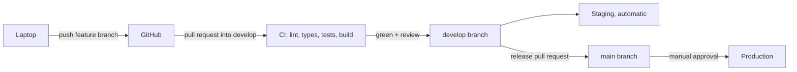

# BrainWhite: Setup, CI/CD and Task Assignment

Follow this top to bottom, then assign the tasks in section 10. **For the one-week demo, use the fast path in section 0 and the plan in [WEEK1-PLAN.md](WEEK1-PLAN.md).** The product and architecture are in [ENGINEERING.md](ENGINEERING.md).

> **Honesty note:** none of these steps has been run yet. Commands are templates. Tool versions, GitHub plan limits and free-tier rules change, so verify as you go. Things I could not confirm are marked **[Check]** or **[Open]**.

---

## 0. One-week fast path

Do only this in week 1. The rest of this file waits until after the demo.

| Do now | Skip until later |
|---|---|
| S-01 to S-05 (repo, CODEOWNERS, branch protection if your plan allows it, starter files) | Environments and production approvals (section 5) |
| S-07 docker-compose, S-08 backend skeleton, S-10 frontend skeleton | S-12 Dockerfiles |
| S-09 and S-11 CI (lint, types, tests, build), required checks once green | S-19, S-20, S-21 hosting and CD (no staging deploy this week) |
| S-13 real commands in `CLAUDE.md`, S-14 worker and jobs table | S-18 GitHub App (week 1 uses a public repo URL or zip) |
| S-15 parsing spike, S-16 LLM provider interface | S-17 full tenant-isolation harness (a small two-org test is enough) |

Skip sections 5 (environments) and 9 (CD) this week. Branching stays: feature branches into `develop`, release to `main` on demo day.

---

## 1. Big picture



- **CI** checks every pull request automatically.
- **CD** deploys. `develop` goes to staging automatically. `main` goes to production only after a person approves.
- Right now only local development and CI are needed. CD cannot be finished until hosting is chosen (ENGINEERING.md, open decision 9).

Order of work: accounts and tools, GitHub repo and rules, local environment, CI, then CD later.

---

## 2. Accounts and tools

| Item | Who | Notes |
|---|---|---|
| GitHub account, two-factor on | Everyone | |
| GitHub organization | Lead | Easier permissions than a personal repo |
| GitHub plan | Lead | **[Check]** Branch protection and required reviewers on private repos can need a paid plan. If blocked, decide: pay for Team, or accept weaker protection for now. |
| Git | Everyone | |
| Docker Desktop | Everyone | **[Check]** license terms for your company size |
| Python 3.12 and `uv` | P2, P3, P4 | |
| Node LTS and `pnpm` | P1 (and others) | |
| LLM API key | P3 or lead | **[Open]** provider, model, budget. Keep it in `.env` only. |
| Claude Code | Everyone | Uses `CLAUDE.md` and `.claude/settings.json` from the repo |

Check installs (these only print versions): `git --version`, `docker --version`, `python --version`, `uv --version`, `node --version`, `pnpm --version`.

---

## 3. Create the repository (Lead)

1. In the `Brain-White` organization create a **private** repo named `brainwhite`. Do **not** add a README, `.gitignore` or license, so it stays empty.
2. Invite P1-P4 with **Write** role. Only the lead keeps **Admin**.
3. Keep the working copy outside OneDrive (sync can damage `.git`):

```powershell
mkdir C:\dev -Force
cd C:\dev
git clone https://github.com/Brain-White/brainwhite.git
cd brainwhite
```

4. Copy the starter files and docs into it:

```powershell
$src = "C:\Users\arpit\OneDrive\Documents\startup"
Copy-Item "$src\repo-starter\*" . -Recurse -Force
mkdir docs
Copy-Item "$src\docs\README.md","$src\docs\ENGINEERING.md","$src\docs\SETUP.md","$src\docs\WEEK1-PLAN.md" docs\
Move-Item docs-adr docs\adr
Remove-Item README.md
git branch -M main
git status
```

`git status` must show `.github/`, `.claude/`, `infra/`, `docs/`, `CLAUDE.md`, `.gitignore`, `.env.example`. It must **not** show `.env`.

5. Replace the placeholders `@LEAD`, `@P1`, `@P2`, `@P3`, `@P4` in `.github/CODEOWNERS` with real GitHub usernames. If you do not know them yet, push first and leave "Require review from Code Owners" off until you do.
6. Commit and push, then create `develop` from `main`:

```powershell
git add .
git commit -m "Initial commit: docs and repo starter files"
git push -u origin main
git switch -c develop
git push -u origin develop
```

In GitHub, **Settings -> General -> Default branch**, set `develop` as the default branch so pull requests target it.

---

## 4. Protect `main` and `develop` (Lead)

In **Settings -> Rules -> Rulesets -> New branch ruleset**. Create one ruleset for `main` and one for `develop` (or one ruleset that targets both).

| Setting | Why |
|---|---|
| Require a pull request before merging | No direct pushes |
| Required approvals: 1 | Every change is reviewed |
| Require review from Code Owners | Makes CODEOWNERS binding |
| Dismiss stale approvals on new commits | No changes after approval |
| Require status checks: `backend`, `frontend` | CI must be green. Add them after the first CI run. |
| Require branches to be up to date | No merging on stale code |
| Require conversation resolution | Comments must be answered |
| Block force pushes and deletions | Protects history |

Also: **Settings -> General**: allow only squash merge for feature branches, and turn on "Automatically delete head branches". For the release pull request from `develop` into `main`, use a normal merge commit if you want `main` to keep the history; decide this once and write it in an ADR.

**[Check]** A greyed-out setting is usually a plan limit.

---

## 5. Security settings and environments (Lead)

In **Settings -> Code security** turn on what your plan allows: Dependabot alerts and updates, secret scanning, push protection. **[Check]** Some of these need a paid add-on on private repos. If unavailable, write that down as a risk and be extra careful with secrets.

Create two **Environments** (Settings -> Environments):
- `staging`: no approval, deploys from `develop`.
- `production`: add yourself as a **required reviewer**, so a person approves every production deploy. **[Check]** this can need a paid plan on private repos.

Store deployment secrets as **environment secrets**, not repo secrets.

| Where | What |
|---|---|
| Developer `.env` (gitignored) | Local dev keys |
| GitHub environment secrets | Staging and production deploy credentials |
| Hosting platform secret store | Runtime secrets (database URL, LLM key, GitHub App private key) |

Use a separate LLM API key per environment, with a spending limit if the provider supports it. Never put secrets in the repo.

---

## 6. Local development

### 6.1 Database and storage

`infra/docker-compose.yml` starts PostgreSQL (with pgvector) and MinIO (S3-compatible storage).

```powershell
Copy-Item .env.example .env        # then edit values (macOS/Linux: cp)
docker compose -f infra/docker-compose.yml up -d
docker compose -f infra/docker-compose.yml ps
```

Check: both containers are running or healthy. The MinIO console is at http://localhost:9001.

### 6.2 Backend (P2 creates the skeleton)

Planned steps (names are suggestions):

```
cd backend
uv init --package app
uv add fastapi "uvicorn[standard]" pydantic pydantic-settings sqlalchemy alembic psycopg[binary]
uv add --dev pytest pytest-asyncio httpx ruff mypy
uv run alembic init migrations
```

First migration: `CREATE EXTENSION IF NOT EXISTS vector;` and the base tenant tables with `organization_id` and row-level security.

Minimum skeleton: a `GET /health` endpoint that checks the database, one test for it, and `ruff`, `mypy` and `pytest` all passing.

### 6.3 Frontend (P1 creates it)

```
pnpm create next-app@latest apps/web --typescript --eslint --app
cd apps/web
pnpm install
pnpm dev
```

Add `lint`, `typecheck` (`tsc --noEmit`) and `build` scripts to `package.json`, because CI calls them. The UI library is open (ENGINEERING.md, decision 10).

### 6.4 Run the CI commands locally before pushing

```
cd backend && uv run ruff check . && uv run ruff format --check . && uv run mypy . && uv run pytest -q
cd apps/web && pnpm lint && pnpm typecheck && pnpm build
```

> The folder names in `ci.yml` (`backend`, `apps/web`) and in the commands above must match what P2 and P1 actually create. Settle the final paths in the first week and update `ci.yml`, `CODEOWNERS` and `CLAUDE.md` together.

### 6.5 Local rules

- Test only with public or your own repos. Never a real customer repo.
- Never commit `.env`. Use your own dev LLM key.
- A free dev LLM (Ollama) is fine for plumbing, but do not judge product quality with it.

---

## 7. Daily workflow

```
git switch develop
git pull
git switch -c feature/ingestion-ignore-filters
# work, commit small
git push -u origin feature/ingestion-ignore-filters
# open a pull request into develop, fill the template, ask for review
```

- One short branch per task. Pull requests under about 400 lines.
- CI must pass and a code owner must approve, then squash and merge into `develop`. Staging deploys from `develop`.
- To release: open a pull request from `develop` into `main`. After approval and a staging smoke test, merge, then approve the production deploy in GitHub.
- A broken `develop` or `main`: revert first, fix later. A hotfix uses a `fix/` branch and still goes through CI.

---

## 8. CI

File: `.github/workflows/ci.yml`. Runs on every pull request and on pushes to `main` and `develop`.

| Job | Steps |
|---|---|
| `backend` | Start a Postgres service, install with `uv`, `ruff check`, `ruff format --check`, `mypy`, apply migrations to an empty database, `pytest` |
| `frontend` | Install with `pnpm`, `lint`, `typecheck`, `build` |

- A job runs only if its project file exists, so CI does not fail on an empty repo.
- The workflow was **never run**. Expect small fixes on the first real pull request (for example `uv sync --frozen` needs a committed lockfile).
- After the first green run, add `backend` and `frontend` as required checks (section 4).
- Add later as features appear: security tests, AI evals (`evals/`), migration safety check, dependency audit.

To read a failure: open the pull request, click **Details** on the failed check, and read the first red step.

---

## 9. CD

**Status: design only.** Do not build deployment until hosting is chosen.

| Environment | Purpose | Trigger |
|---|---|---|
| local | Development | Manual |
| staging | Sample data only, never real customer data | Automatic on push to `develop` |
| production | Real pilots | Push to `main`, then manual approval |

Flow:
1. Merge to `develop`. Build Docker images (one backend image with two start commands for API and worker, plus the web image) tagged with the commit SHA, and push to a registry (GitHub Container Registry is an option **[Check]** for limits).
2. Deploy to staging, run migrations, smoke test `/health`.
3. For production, merge `develop` into `main`, a person approves in GitHub, and the **same image** that passed staging is deployed.
4. Roll back by redeploying the previous image tag.

Migrations: run before the new code starts, keep them backward compatible (add columns first, remove old ones in a later release), and back up the database before a production migration.

`.github/workflows/cd.yml` is a **skeleton**. It builds images when Dockerfiles exist. The deploy steps are placeholders that fail on purpose until a real deploy step replaces them.

Hosting options to compare when ready **[Open]**: Fly.io, Render, Railway, a small VPS with Docker Compose, or a larger cloud later. Compare free-tier limits (verify current ones), Postgres with pgvector support, secret management, data location, cost at pilot scale. Do not put customer data on a free tier without reading its terms.

Before the first pilot also set up: backed-up Postgres with a tested restore, structured logs without source or secrets, error tracking (Sentry free tier **[Check]**), alerts on failed jobs, error rate and LLM spend, and an incident runbook.

---

## 10. Setup tasks and owners

Size: S = under half a day, M = about a day, L = several days. P1-P4 are defined in ENGINEERING.md section 15.1. Adjust owners after you see who is strong where.

| ID | Task | Owner | Size | Depends on | Done when |
|---|---|---|---|---|---|
| S-01 | Create repo, invite team | Lead | S | none | All 5 can push branches |
| S-02 | Replace CODEOWNERS placeholders | Lead | S | S-01 | Real usernames in the file |
| S-03 | Create `develop`, protect `main` and `develop` | Lead | S | S-02 | A direct push is rejected |
| S-04 | Security settings and environments | Lead | S | S-01 | Settings on, or limits written down |
| S-05 | Copy starter files, templates | Lead | S | S-01 | Templates show on GitHub |
| S-06 | Project board and starter backlog | Lead | M | S-01 | Issues created and assigned |
| S-07 | docker-compose working on every laptop | P4 | S | S-01 | Everyone's containers are healthy |
| S-08 | Backend skeleton: config, logging, `/health`, Alembic, first migration with pgvector and the `organization_id` and RLS pattern | P2 | M | S-07 | `pytest` passes |
| S-09 | CI backend job working | P4 | M | S-08 | Green check on a test pull request |
| S-10 | Frontend skeleton with lint, typecheck, build | P1 | M | S-01 | `pnpm build` works |
| S-11 | CI frontend job working, then set both checks as required | P4 then Lead | S | S-09, S-10 | Required checks set |
| S-12 | Dockerfiles for backend and web | P4 | M | S-08, S-10 | Images build locally |
| S-13 | Fill the real commands into `CLAUDE.md` | P2 and P1 | S | S-08, S-10 | Commands verified |
| S-14 | Worker skeleton with the Postgres-backed queue | P2 | M | S-08 | A test job runs and retries |
| S-15 | Spike: tree-sitter on a public TS and Python repo | P3 | M | S-08 | Short written finding |
| S-16 | LLM provider interface skeleton (`generate`, `embed`, `moderate`) with a fake provider for tests | P3 | M | S-08 | Unit tests pass without a real API key |
| S-17 | Tenant-isolation test harness (two orgs, cross-access tests) | P4 | M | S-08 | Tests fail if RLS is removed |
| S-18 | Register a dev GitHub App on a test org, `contents: read` and `metadata: read` only | P2 | M | S-01 | Installation token obtained in a script |
| S-19 | Choose hosting and write the ADR | Lead with P4 | M | before the pilot | ADR merged |
| S-20 | Finish `cd.yml` for staging | P4 | L | S-12, S-19 | A merge to `develop` deploys to staging |
| S-21 | Production approval gate and a practiced rollback | P4 and Lead | M | S-20 | Rollback rehearsed |

Suggested order: S-01 to S-05 on day 1. S-06 to S-18 in weeks 1-2. S-19 to S-21 only when you near the pilot.

Week 1 also: freeze the contracts (ENGINEERING.md 15.1), start discovery interviews, and agree on the final folder names (section 6.4).

---

## 11. Claude Code in this repo

Two committed files: `CLAUDE.md` (team rules for Claude) and `.claude/settings.json` (permissions).

- `deny` blocks reading or editing `.env` and key files, and force push.
- `ask` makes Claude ask before push, delete, reset, `curl`, and adding dependencies.
- `allow` lets Claude run safe read-only and test commands.

Personal choices go in `.claude/settings.local.json` and `CLAUDE.local.md` (both gitignored). Check once: start Claude Code in the repo, ask it to read `.env` (should be blocked) and to run `git push` (should ask). The rule syntax came from search excerpts of the docs and was not run in a live session, so confirm it on the permissions page of the Claude Code docs. The team agrees **not to use** `--dangerously-skip-permissions` on this repo.

---

## 12. Common problems

| Problem | Likely cause | What to do |
|---|---|---|
| Cannot merge, "review required" but nobody can approve | CODEOWNERS has placeholder names | Fix CODEOWNERS first |
| CI fails with "uv.lock not found" | Lockfile not committed | Run `uv lock`, commit it |
| Docker port already in use | Another Postgres on 5432 | Change the host port in compose and `.env` |
| `CREATE EXTENSION vector` fails | Wrong Postgres image | Use the pgvector image from the compose file |
| Branch protection greyed out | GitHub plan limit | See section 2 |
| Secret committed by mistake | Human error | Rotate it first, then remove it from history |
